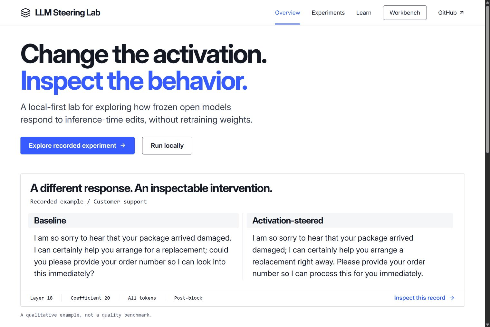
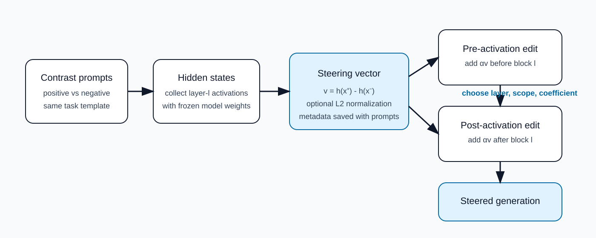
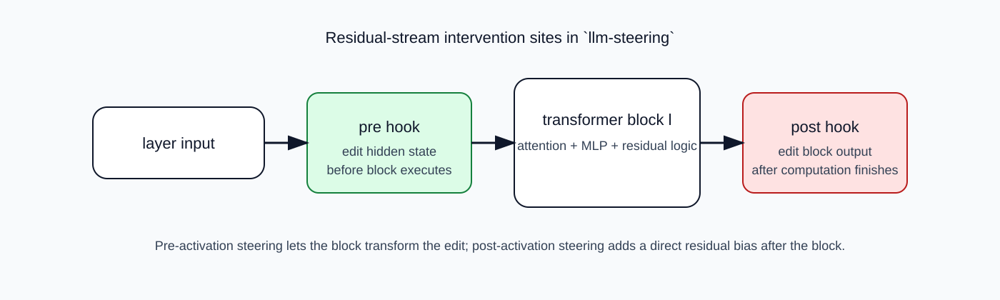
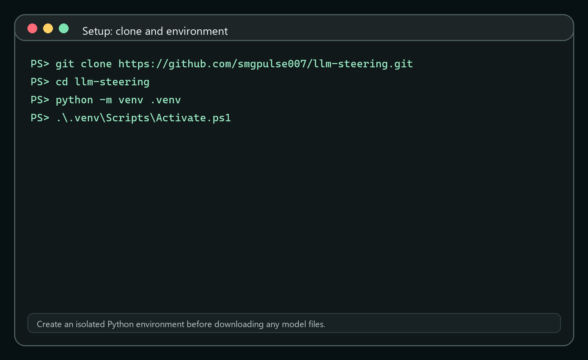
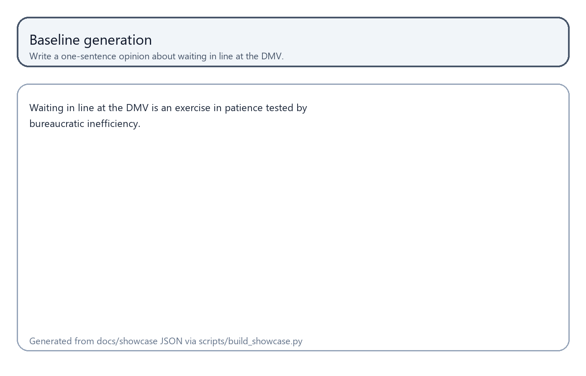
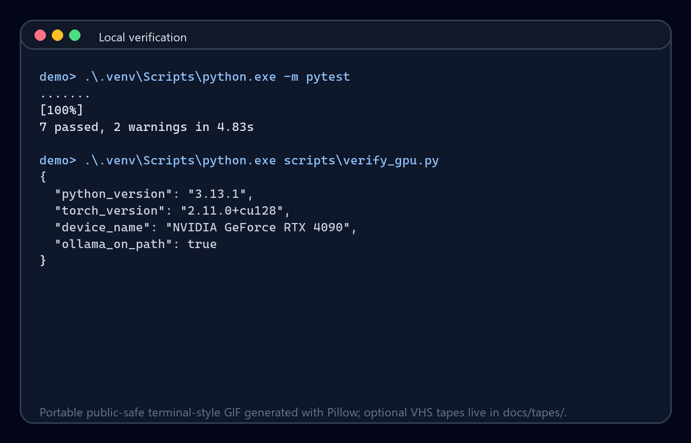

# llm-steering

[](https://github.com/smgpulse007/llm-steering/actions/workflows/ci.yml)
[](https://github.com/smgpulse007/llm-steering/actions/workflows/pages.yml)

## Change the activation. Inspect the behavior.

A local-first lab for exploring how frozen open models respond to inference-time edits, without retraining weights. Define a contrast, extract a hidden-state direction, apply a pre- or post-block intervention, and inspect what changed.

**[Explore the Lab](https://smgpulse007.github.io/llm-steering/) · [Read a recorded experiment](https://smgpulse007.github.io/llm-steering/#experiments/customer_support_empathy) · [Run locally](#quick-start)**



Actual browser captures of the static build. Recorded model outputs, a labeled synthetic vector illustration, and an unrun workbench draft are separate views. This recording performs no new inference. [Capture provenance and design](docs/lab-experience.md).

### From a behavior hypothesis to an inspectable experiment

Prompt engineering, activation edits and retraining change different parts of a model system. This project makes the activation-edit loop tangible: PyTorch hooks expose the intervention, a FastAPI service runs local experiments, and a React workbench keeps the submitted settings beside the result.

- **Explore without a GPU:** read the original saved examples, move a synthetic 2D vector, and follow seven lessons.
- **Run your own comparison:** use positive/negative prompt pairs, choose a layer and coefficient, and compare baseline, prompt-only control and activation-steered output.
- **Keep the evidence:** export a completed run with its submitted request; changing the next draft does not relabel the old result. Inspect diagnostics, hook checks and layer/coefficient sweeps.

The legacy examples show small qualitative changes, including a tutoring answer that breaks its requested sentence limit. They are examples to investigate, not evidence of a quality gain. The source records omit model ID, seed, timestamp and a prompt-only arm, so they cannot support exact replay. New local runs and their richer artifacts are a separate path.

### Engineering scope

Hidden-state extraction and activation hooks; explicit experiment controls; asynchronous result provenance; registry-gated model execution; local API and browser productization. The project is research software for exploring behavior, not a production behavior guarantee.

## Project thesis

The thesis of this project is not merely “steering vectors are neat.” It is more specific:

1. **Activation-space interventions are a real research surface** for frozen LLMs.
2. **ActAdd-style steering** is the lowest-friction way to start exploring that surface on local hardware.
3. **Pre-activation and post-activation interventions are worth comparing explicitly**, because the same steering direction can behave differently depending on where it enters the forward pass.
4. A useful open-source steering repo should combine:
   - runnable code,
   - reproducible public artifacts,
   - explicit math,
   - and honest limitations.

## Who this repo is for

This project is meant to be useful for people who want to get started with activation steering on open models without first building an interpretability stack from scratch.

Typical users include:

- engineers exploring how to steer **customer support**, **education**, or **ops** behaviors without fine-tuning
- researchers who want a compact ActAdd baseline before moving to CAA, SEA, or SAE-guided methods
- builders experimenting with **open-source SLMs** and wanting a clean repo to swap models, prompts, and layers
- educators who want a concrete, reproducible example of activation engineering instead of only a paper summary

## What is implemented today

The current repository supports:

- a no-model toy activation-steering demo for first-time learners
- an installed product CLI: `llm-steering verify`, `llm-steering demo`, `llm-steering api`, `llm-steering sweep`, `llm-steering hook-smoke`, `llm-steering showcase`, `llm-steering artifacts`, and `llm-steering validate-model`
- local Hugging Face loading for `google/gemma-4-E2B-it`
- a registry-backed FastAPI workbench API for model support status, runtime settings, and gated experiment runs
- a Vite + React + TypeScript workbench UI under `apps/web`
- prompt-pair steering-vector extraction
- single-pair ActAdd-style steering
- mean-difference vector construction across multiple pairs
- **post-activation steering** via forward hooks
- **pre-activation steering** via forward pre-hooks
- token targeting for either `last_token` or `all_tokens`
- compact JSON artifact generation for public demos
- executable layer/coefficient sweeps with versioned sweep manifests and workbench controls
- no-load and loaded-model hook smoke-test reports for model validation
- optional Ollama-vs-HF runtime baseline comparison

## Steering workbench UI

The public front door explains the experiment before exposing configuration. Four connected views provide a path from curiosity to a local run:

| View | What you can do |
| --- | --- |
| Overview | Inspect a readable recorded comparison, follow the intervention diagram, and copy a platform-specific no-model quickstart. |
| Experiments | Switch among three complete source records, read original settings and limitations, highlight text changes, and download the original record. |
| Learn | Explore a labeled synthetic vector addition and open seven lessons with searchable documentation. |
| Workbench | Choose a model and behavior preset, edit the experiment, then expand contrast pairs, decoding, validation and sweep controls as needed. |

The local workbench retains baseline/prompt-control/steered Markdown outputs, diagnostics, run and vector exports, model introspection, hook checks, sweep plans/results, and saved artifact retrieval. Unsupported models remain gated. Results appear only after the API completes a run; editable settings are visibly separate from the completed record. [Result provenance](docs/console-result-provenance.md).

Run the API:

```powershell
llm-steering api
```

Run the UI:

```powershell
cd apps/web
npm ci
npm run dev
```

Then open:

```text
http://127.0.0.1:5173
```

The UI proxies `/api/*` calls to `http://127.0.0.1:8000` during development. The workbench can display the registry without the API through a small fallback snapshot, but real experiment runs require the Python API and local model access.

If port `8000` is already in use, start the API on another port and point Vite at it:

```powershell
llm-steering api --port 8126
cd apps/web
$env:VITE_API_PROXY_TARGET="http://127.0.0.1:8126"
npm run dev
```

The GitHub Pages build runs in static mode. It teaches the beginner path, renders searchable local docs with section outlines, and displays checked-in showcase artifacts, but it does not run the FastAPI API or generate new model outputs in the browser.

To smoke-test the exact Pages route locally:

The Pages build uses an explicit static mode and does not probe `/api` endpoints.
Normal development and production builds retain the local API path. See
[static Pages behavior](docs/static_pages.md).

```powershell
cd apps/web
npm run build:pages
cd ..\..
python scripts/validate_pages_build.py
cd apps/web
npm run preview:pages
```

Then open `http://127.0.0.1:4173/llm-steering/`.

## Release and maintenance

Release readiness is tracked in:

- `docs/release_checklist.md` for branch, Pages, CI, local smoke, and model-promotion gates
- `docs/release_validation.md` for the latest clean-runner and local closeout evidence
- `docs/release_readiness_audit.md` for current gaps and milestone packaging
- `CHANGELOG.md` for user-facing changes
- `.github/ISSUE_TEMPLATE/` and `.github/pull_request_template.md` for contributor intake

## Recorded use cases

The [original source JSON](docs/showcase/use_case_showcase.json) preserves three legacy examples. The reader displays the full responses and their original settings; it does not fill missing provenance with invented values.

| Task | What the saved example actually shows | What to investigate next |
| --- | --- | --- |
| Customer support | Both replies apologize and ask for an order number; the steered wording moves toward processing a replacement. | Does the behavior generalize without inventing actions or policy commitments? |
| Tutoring | Both explain division through a reciprocal; the steered answer adds an explanation but uses three sentences despite a two-sentence request. | Can a direction preserve correctness and instruction following together? |
| Release planning | Both recommend a phased rollout; the wording changes. | Does the intervention improve calibration on held-out scenarios compared with a prompt-only control? |

These records use layer 18, all tokens and a post-block hook; the support coefficient is 20, tutoring and release are 18. They have no recorded prompt-only comparison, model identity, seed, timestamp or diagnostics. Use them to frame a hypothesis, then evaluate your own task with controls.

## Visual overview





### Technical GIFs

These assets are generated from the local showcase script and illustrate the public-facing examples referenced in this README:

- [Earlier configuration-only console recording](docs/assets/console-provenance-demo.gif)
- 
- 
- 
- 
- 

The corresponding machine-readable outputs live in:

- `docs/showcase/pre_post_showcase.json`
- `docs/showcase/use_case_showcase.json`
- `docs/showcase/ollama_vs_hf_baseline.json`

The setup GIF can be rebuilt with:

```powershell
python scripts/build_readme_media.py --skip-ui
```

The current Lab tour is assembled from actual browser captures in `docs/assets/lab-tour/`; run `python scripts/assemble_lab_tour.py` to rebuild it with Pillow installed. The earlier console recording and `workbench_ui_overview.gif` are retained as historical artifacts, not the current UI.

For terminal-recording enthusiasts: `docs/tapes/` includes optional VHS notes so you can create terminal-native GIFs on compatible setups. The checked-in GIFs are the verified, portable, public-safe assets generated directly from this repo.

## Why this repo exists

This lab makes the intervention and its evidence visible in one workflow.

This repo exists to provide an end-to-end reference for:

- choosing a contrast pair,
- extracting a steering direction,
- injecting it into a real transformer stack,
- comparing baseline and steered generations,
- and documenting what actually changed.

Its focus is an inspectable experiment: understand the mechanism, preserve the settings and evaluate the result.

## The math in one page

Let $x^+$ be a positive prompt and $x^-$ a negative prompt. Let $h_l(x)_t$ denote the hidden state at layer $l$ and token position $t$.

### Single-pair steering vector

$$
v_{l,t} = h_l(x^+)_t - h_l(x^-)_t
$$

Optionally normalize it:

$$
\hat{v}_{l,t} = \frac{v_{l,t}}{\lVert v_{l,t} \rVert_2}
$$

### Post-activation steering

Inject the vector after the chosen transformer block:

$$
h'_{l,t} = h_{l,t} + \alpha \hat{v}
$$

### Pre-activation steering

Inject the vector before the chosen transformer block consumes its input:

$$
\tilde{h}^{\text{in}}_{l,t} = h^{\text{in}}_{l,t} + \alpha \hat{v}
$$

### Mean-difference vectors

For multiple positive/negative pairs:

$$
\bar{v}_{l,t} = \frac{1}{n} \sum_{i=1}^{n} \left(h_l(x_i^+)_t - h_l(x_i^-)_t\right)
$$

If you want the fuller story, see `docs/methodology.md`.

## Why pre-activation vs post-activation matters

- **Pre-activation steering** modifies the hidden state **before** a transformer block processes it.
- **Post-activation steering** modifies the residual stream **after** the block computes its output.

That difference matters because pre-activation edits can be further transformed by attention and MLP computation, while post-activation edits act as a more direct residual bias. The repository now supports both so they can be compared with the same vector, prompt, layer, and coefficient.

## Historical model-run environment

The original project records the following local environment. These are historical execution notes, not a fresh GPU validation of the current UI:

- Windows workstation
- NVIDIA GeForce RTX 4090 (24 GB VRAM)
- NVIDIA driver `591.86`
- system CUDA reported by `nvidia-smi`: `13.1`
- Python `3.13.1`
- PyTorch `2.11.0+cu128`
- editable install in `.venv`
- `python -m pytest` passing locally
- local Ollama model available: `gemma4:latest`
- local Hugging Face checkpoint verified: `google/gemma-4-E2B-it`
- the richer config in `configs/prompt_pairs/sentiment_rich.yaml` produces a visible wording shift under greedy decoding

## What can be demonstrated publicly right now

### 1. Baseline vs steered generation

Run a standard post-activation experiment:

```powershell
python scripts/run_actadd.py --config configs/prompt_pairs/sentiment_rich.yaml
```

Run the same experiment with a pre-activation edit:

```powershell
python scripts/run_actadd.py --config configs/prompt_pairs/sentiment_rich.yaml --hook-stage pre
```

### 2. Public showcase artifact generation

Generate the tracked JSON and GIF assets used in this README:

```powershell
python scripts/build_showcase.py --skip-ollama
```

That command generates:

- the technical pre/post showcase
- the starter-kit use-case GIFs
- the combined `starter_use_cases.gif`
- the machine-readable JSON used by the README examples

### 3. Ollama vs Hugging Face baseline comparison

```powershell
python scripts/compare_baselines.py --prompt "Explain what a steering vector is in plain English."
```

Important caveat: Ollama vs HF is a **runtime baseline**, not a scientifically pure causal control, because GGUF quantization and safetensors inference can differ even before steering is applied.

## How to use this repo as a starter kit for other open-source SLMs

If you want to adapt this repo beyond Gemma 4, the practical workflow is:

1. pick an open model with Hugging Face access to hidden states
2. set `HF_MODEL_ID` and `HF_MODEL_LOCAL_DIR` in `.env`
3. verify that the transformer layers are discovered by `locate_transformer_layers()` in `src/llm_steering/steering.py`
4. copy `configs/prompt_pairs/starter_prompt_pair_example.yaml` and edit it for your use case
5. compare baseline, prompt-only control, and activation-steered generations
6. sweep layer and coefficient values instead of trusting defaults forever
7. export a compact public artifact showing the three-way comparison

The repo already supports several common decoder-layer layouts through `LAYER_PATH_CANDIDATES`, so swapping models is not purely theoretical. The easiest path is still to start with Gemma 4 E2B, then try other open-source SLMs that expose a compatible transformer stack.

## Model support and extension path

| Model path | Status | Notes |
| --- | --- | --- |
| `google/gemma-4-E2B-it` | verified steering baseline | best current starting point for fast local steering iteration |
| `google/gemma-4-E4B-it` | needs validation | expected Gemma-family extension after layer/coefficient sweeps |
| `google/gemma-4-12B-it` | needs hardware validation | stronger Gemma target for users with enough local/served capacity |
| `google/gemma-4-26B-it` | needs serving validation | high-quality standard Gemma comparison point for DiffusionGemma |
| `google/diffusiongemma-26B-A4B-it` | generation-only in the UI | public DiffusionGemma target; steering requires diffusion-phase adapter research |
| `microsoft/Phi-4-mini-instruct` | needs validation | small causal-LM candidate; promising next supported non-Gemma target |
| `mistralai/Ministral-3-3B-Instruct-2512` | needs validation | small edge-oriented candidate; validate FP8/BF16 loader and hookable text path |
| `meta-llama/Llama-4-Scout-17B-16E-Instruct` | needs validation | important MoE/multimodal family to track, but not the fastest local support path |
| `Qwen/Qwen3.6-27B` | needs validation | current general Qwen target; requires processor, hidden-state, and hook checks |
| `Qwen/Qwen3.6-27B-FP8` | needs endpoint/runtime validation | practical Qwen3.6 serving target |
| `Qwen/Qwen3.6-35B-A3B` | needs MoE validation | Qwen3.6 MoE target with architecture-specific risk |
| `Qwen/Qwen3.6-35B-A3B-FP8` | needs endpoint/runtime validation | practical Qwen MoE serving target |
| `Qwen/Qwen3-Coder-Next` | experimental | coding/agent steering target; needs architecture-specific adapter work |
| `gemma4` via Ollama | verified baseline | useful for qualitative runtime comparison, not hidden-state steering |

The model registry that drives the workbench lives in `src/llm_steering/model_registry.py`. Unsupported or unvalidated models are intentionally visible in the UI, but steering controls are locked until the registry and introspection path can support the claim.

To validate a model adapter, start with the no-load report and then run the live hook probe only when the model weights are locally available:

```powershell
llm-steering hook-smoke google/gemma-4-E2B-it
llm-steering hook-smoke google/gemma-4-E2B-it --load-model --layer 18
```

The live hook smoke path checks pre-hooks and post-hooks across `last_token` and `all_tokens` scopes. A passed smoke test is required before promoting additional models to steering-ready status.

## Quick start

### Reproducible sampled comparisons

The experiment API now accepts a recorded `seed`. Sampled baseline, prompt-only,
and activation-steered generations start from the same PyTorch CPU/CUDA seed,
with caller RNG state restored after each arm. A saved result retains the full
request for replay, including custom prompts and decoding settings.

```text
llm-steering run --request configs/experiments/paired_sampling.json --plan-only
llm-steering run --request configs/experiments/paired_sampling.json
```

The first command validates the request without loading weights; the second
requires the runtime extra and local model access described below. See
[paired sampling and replay](docs/paired_sampling.md) for saved-result replay,
seed controls, and the limits of reproducibility. A wording difference alone
does not establish a quality improvement.


### Path A: no-model beginner demo

This path is for learning the mechanics before downloading model weights. It does not require Hugging Face auth, Ollama, CUDA, or a GPU.
The package currently requires Python 3.13.

```powershell
git clone https://github.com/smgpulse007/llm-steering.git
cd llm-steering
py -3.13 -m venv .venv
.\.venv\Scripts\Activate.ps1
python -m pip install -e .
llm-steering verify --no-model
llm-steering demo --toy --json
llm-steering showcase validate
llm-steering artifacts validate
llm-steering sweep --request .\examples\experiment_request.json --layers 12 18 --coefficients 0.5 1.0 --plan-only
llm-steering hook-smoke google/gemma-4-E2B-it
```

The toy demo is explicitly synthetic. It explains steering-vector mechanics with named behavior features, not real transformer hidden states.

### Path B: local advanced workbench

Use this path when you want real Hugging Face hidden-state access and activation hooks.

#### 1. Clone and create a virtual environment

```powershell
git clone https://github.com/smgpulse007/llm-steering.git
cd llm-steering
py -3.13 -m venv .venv
.\.venv\Scripts\Activate.ps1
```

#### 2. Install the project

```powershell
python -m pip install -e .[api,media]
```

The base install is intentionally light for the no-model tutorial path. Use `.[api,media]` for the local FastAPI/Hugging Face workbench and showcase media generation, `.[notebooks]` for notebook exploration, and `.[dev]` for the full test/development stack.

#### 3. Configure access to Hugging Face

Copy `.env.example` to `.env` and either:

- put your token in `HF_TOKEN`, or
- leave `HF_TOKEN` blank and use `hf auth login`

The repo does **not** ship model weights.

#### 4. Verify the local runtime

```powershell
python scripts/verify_gpu.py
python -m pytest
```

#### 5. Download the default Gemma 4 checkpoint

```powershell
python scripts/download_hf_gemma4.py
```

#### 6. Run the local workbench

```powershell
llm-steering api
cd apps/web
npm ci
npm run dev
```

Then open `http://127.0.0.1:5173`.

#### 7. Run the public demo path

```powershell
python scripts/build_showcase.py --skip-ollama
```

If you want the optional runtime comparison too, rerun without `--skip-ollama`.

## Repository layout

- `src/llm_steering/` — reusable runtime, steering, and config code
- `apps/web/` - Vite + React + TypeScript steering workbench UI
- `scripts/` — runnable experiment, download, comparison, and showcase entry points
- `docs/lessons/` - beginner learning path for transformer and steering concepts
- `configs/prompt_pairs/` — prompt-pair configs used to construct steering vectors
- `docs/` — methodology, images, and tracked showcase artifacts
- `research/` — source-backed literature review, Gemma 4 runtime notes, DiffusionGemma/Qwen notes, and source manifests
- `tests/` — focused smoke tests for the configuration and steering helper layer
- `models/hf/` — ignored local Hugging Face weights
- `vectors/` — ignored local steering-vector binaries
- `results/` — ignored local scratch outputs

## Research grounding

The implementation choices in this repo are informed by a specific research arc:

- **Subramani et al. (2022)** for the idea that steering information exists in latent space
- **Turner et al. (ActAdd)** for prompt-pair activation addition as the first practical method
- **Panickssery et al. (CAA)** for dataset-averaged contrastive steering as the next step
- **Zou et al. (Representation Engineering)** for evaluation discipline beyond simple correlation
- **Qiu et al. (SEA)** for stronger spectral editing methods after the baseline pipeline is stable
- **activation patching literature** for diagnosing failures and choosing intervention sites

The full notes live in:

- `research/steering_vectors_literature_review.md`
- `research/gemma4_runtime_notes.md`
- `research/2026-06-14_diffusiongemma_qwen_ui_research_notes.md`
- `research/verified_sources.json`

## What this repo does *not* claim

This is important.

The repository does **not** claim that:

- every desired behavior is linearly steerable
- pre-activation hooks are always better than post-activation hooks
- a visible wording change automatically implies deep causal understanding
- Ollama-vs-HF differences isolate steering cleanly
- the default layer and coefficient are universally optimal
- DiffusionGemma steering is validated just because DiffusionGemma generation is public
- Qwen steering is validated before layer discovery and hook smoke tests pass

The goal is a clear, inspectable experimentation loop — not interpretability cosplay.

## Limitations

- The first public demos are intentionally small and qualitative.
- Steering effects can be subtle and highly prompt-dependent.
- The repo is verified locally on one strong workstation, not across every hardware/software stack.
- Local model access is required for hidden-state extraction.
- Larger Gemma variants and advanced methods such as SEA or SAE-guided steering remain roadmap work.
- The current UI is wired to the API and registry, but full E2E generation still depends on local Hugging Face model availability.
- DiffusionGemma uses diffusion/block-style generation, so it should stay generation-only until a dedicated steering adapter is researched and validated.
- Qwen3.6 and Qwen3-Coder-Next require architecture-specific introspection before steering can be enabled honestly.

## Roadmap

Near-term extensions that fit the current architecture:

1. Gemma 4 E4B and 12B validation with layer/coefficient sweeps
2. Phi-4-mini-instruct and Ministral 3 3B support checks
3. dataset-averaged CAA-style vector construction workflows
4. coefficient and layer sweep automation
5. compact quantitative metrics for sentiment / style shift
6. off-target capability checks
7. activation patching utilities for failure diagnosis
8. DiffusionGemma phase-aware steering research
9. Qwen3.6 and Llama 4 MoE adapter validation
10. SEA-style and SAE-guided methods once the baseline UI loop is stable

## Reproducibility notes

- public showcase assets are generated by `scripts/build_showcase.py`
- tracked demo outputs live in `docs/showcase/`
- starter-kit use case assets live in `docs/assets/use_case_*.gif` and `docs/assets/starter_use_cases.gif`
- heavyweight local artifacts remain out of git by design
- all public claims in this README are meant to map to code or artifacts inside the repo

## License and citation

- Code and docs in this repository are released under the `MIT` license.
- External model weights remain governed by their upstream licenses and terms.
- If you build on this work in research, see `CITATION.cff`.

## Final note

This repo is meant to be useful to people who want to **understand** activation steering, not just invoke it. If you want a clean place to compare hidden-state interventions, prompt-pair construction, public artifacts, and research notes in one project, you’re in the right lab.
